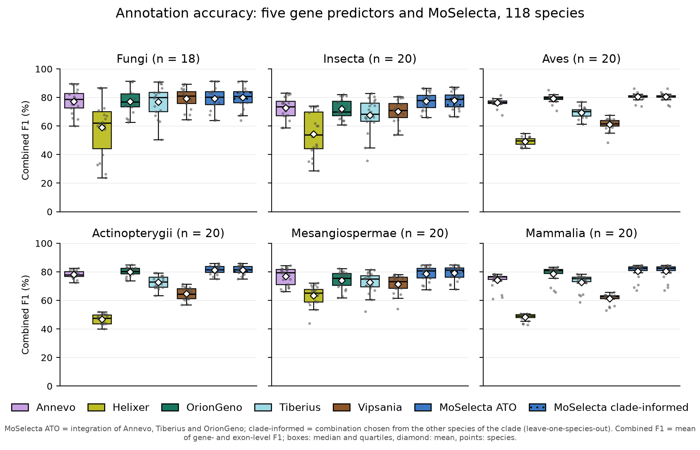
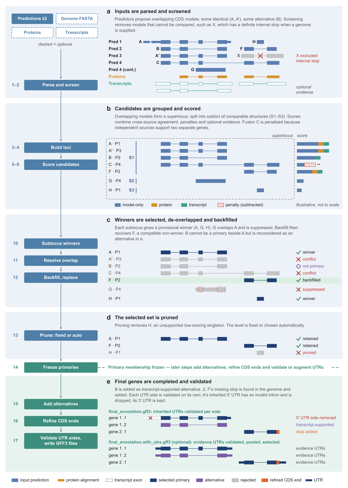

[](https://pypi.org/project/moselecta)
[](https://github.com/EI-CoreBioinformatics/moselecta/releases)
[](https://pypistats.org/packages/moselecta)
[](https://hub.docker.com/r/gemygk/moselecta)

# MoSelecta

MoSelecta integrates coding gene predictions from multiple sources into a single, consistent and auditable annotation. It evaluates competing coding-sequence (CDS) structures using model quality, agreement between prediction sources and optional protein and transcript evidence to select a compatible set of gene models.

MoSelecta can operate without external evidence, while an optional genome FASTA enables additional sequence validation and CDS refinement. See [What MoSelecta does](#what-moselecta-does) for its main capabilities or [How MoSelecta works](#how-moselecta-works) for the workflow schematic.


## Benchmark performance



Across 118 species from six clades, MoSelecta improved gene-annotation accuracy over the individual deep-learning gene predictors, without any external protein or transcript evidence (the runs used the prediction annotations and the genome FASTA only). Both a fixed three-predictor combination (ATO: Annevo, Tiberius and OrionGeno) and a clade-informed choice of inputs exceeded the single predictor selected for the clade from the other benchmark species by about two combined-F1 points on average, in 107 and 111 of the 118 species. Combined F1 is the mean of [Mikado compare](https://mikado.readthedocs.io/en/stable/Usage/Compare/) gene-level F1 (exact CDS structure) and stringent exon-level F1 against the reference annotation. The clade-informed combination is a benchmark-derived recommendation evaluated leave-one-species-out, not something MoSelecta selects automatically.

**[Benchmark results and methodology](docs/benchmark.md)**

## What MoSelecta does

MoSelecta integrates coding gene predictions from multiple sources into a single, auditable annotation. Rather than simply taking a consensus, it evaluates competing CDS structures using cross-source support, model quality and optional external evidence to select a compatible set of gene models.

MoSelecta can operate without external protein or transcript evidence. A genome FASTA is also optional, but **strongly recommended** to enable sequence-integrity checks and CDS-end refinement. Protein and transcript alignments can provide additional support for model selection.

Key capabilities include:

- **Integrating multiple predictors:** Accept gene prediction annotations in GFF3/GTF format, retaining the provenance of individual models.
- **Evaluating competing models:** Compare CDS structures using cross-source agreement, structural completeness, model-quality characteristics and optional evidence.
- **Resolving conflicts and recovering genes:** Select compatible models, resolve overlapping predictions and recover eligible candidates through backfill.
- **Controlling annotation quality:** Apply configurable or reference-free automatic pruning, with diagnostic reports explaining selection and removal decisions.
- **Supporting alternative transcripts:** Add supported alternative coding isoforms without changing the selected primary gene set.
- **Refining the final annotation:** Optionally refine incomplete CDS termini using genome sequence, validate inherited UTRs and generate a separate UTR-augmented annotation with `--add-utrs`.

The [workflow schematic](#how-moselecta-works) illustrates these processes, while the [user guide](docs/user-guide/MoSelecta-v0.3.0-user-guide.pdf) provides detailed instructions and explanations.

## Requirements

- Python `>=3.10,<3.16`
- candidate annotations containing usable CDS records
- a writable parent directory for the output prefix
- optional uncompressed genomic FASTA, protein-evidence GFF/GTF, and transcript-evidence GFF/GTF files

## Installation

### Python:

Install latest version of MoSelecta with:

```bash
pip install moselecta
```

### Docker:

Pull the latest MoSelecta image from Docker Hub with:

```bash
docker pull gemygk/moselecta
```

See [INSTALLATION.md](INSTALLATION.md) for environment, Docker, wheel, source, and build instructions.

## Inputs at a glance

Supply gene prediction annotations using `--inputs`. Each input must contain CDS features that can be associated with transcripts. MoSelecta accepts GFF3/GTF annotations and supports multiple input files.

Use `--source-name` to assign a unique label to each input file. If omitted, labels are derived from filenames. Input lists can also be supplied using `@FILE` manifests. See the [configuration reference](docs/configuration.md) for details.

Malformed or unusable records are reported and, where possible, skipped. Use `--strict` to make applicable input-validation errors fatal.

We strongly recommend using at least three complementary, independently generated gene-prediction sources for routine analyses. Although MoSelecta can operate with two sources and evidence, three or more provide stronger corroboration when predictions disagree and allow more informative assessment of structural consensus. However, more sources are not necessarily better: closely related prediction sets may inflate apparent support and may be better combined into a single source. Similar care should be taken when reusing protein or transcript evidence that contributed to generating the predictions. See [Guidance on selecting prediction sources and supporting evidence](docs/input-source-guidance.md).

### Optional inputs

- **Genome sequence (`--genome-fasta`) — strongly recommended.** Enables sequence-integrity checks, including detection of definite internal stop codons, and post-selection refinement of incomplete CDS termini. If the FASTA index (`.fai`) is missing or outdated, MoSelecta creates or rebuilds it; the FASTA directory must therefore be writable when indexing is required.
- **Protein evidence (`--evidence-proteins`).** Supplies protein-alignment evidence to support the scoring and selection of coding gene models.
- **Transcript evidence (`--evidence-transcripts`).** Supplies transcript-alignment evidence for model scoring and selection, and provides transcript structures for optional UTR augmentation.

Protein and transcript evidence can be supplied independently or together. Neither is required to run MoSelecta.

### Optional annotation output

Use `--add-utrs` to generate a separate UTR-augmented annotation using eligible UTR structures from input predictions and/or transcript evidence. UTR augmentation occurs after the primary coding gene set has been finalised and does not change the selected CDS models.

MoSelecta can operate using prediction annotations alone. Without a genome FASTA or external evidence, the corresponding sequence-based checks, refinements and evidence-dependent calculations are unavailable.


## Running on your own data

For a real evidence-aware analysis:

```bash
mkdir -p results
moselecta \
  --inputs predictor_a.gff3 predictor_b.gff3 predictor_c.gff3 \
  --source-name predictor_a predictor_b predictor_c \
  --genome-fasta genome.fa \
  --evidence-proteins protein_alignments.gff3 \
  --evidence-transcripts transcript_alignments.gff3 \
  --out-prefix results/integrated \
  --add-utrs  
```

This command is schematic because the files are project-specific. Exact source/evidence labels can also be supplied by manifests.

## Example data

The `examples/MoSelecta-bombus-4mb-example.zip` archive demonstrates MoSelecta on the first 4,000,000 bp of the Bombus terrestris reference sequence NC_063270.1. The example combines seven gene-prediction sources with protein and transcript evidence, runs strict input parsing and UTR augmentation, and supplies a compact set of validated reference outputs; see [README](examples/README.md)

## Main outputs

The normal integrated annotation is:

```text
<prefix>.final_annotation.gff3
```

This is the final annotation for the run. It contains retained primary transcripts and any accepted alternatives, with assigned MoSelecta IDs. By default, exon structures extending beyond the CDS may be retained from the input predictions, subject to UTR validation. To generate a CDS-only annotation, where gene, mRNA and exon boundaries are derived from CDS coordinates, use `--final-gff3-cds-only-structure` 

When `--add-utrs` is active, MoSelecta additionally writes:

```text
<prefix>.final_annotation.with_utrs.gff3
```

The UTR file is a separate post-selection product; UTRs are added to CDS models based on either transcript evidence `--evidence-transcripts` or alternative gene models `--inputs` 

Useful standard-profile audit products include:

- `<prefix>.run_configuration.json` - resolved options and provenance;
- `<prefix>.input_summary.tsv` and `<prefix>.validation_failures.tsv` - input accounting;
- `<prefix>.selected_models.tsv` - models selected before backfill/final pruning;
- `<prefix>.backfilled_models.tsv` - ordinary backfill acceptances;
- `<prefix>.final_selected_models.pruned.tsv` - retained population after final pruning;
- `<prefix>.final_selected_models.pruned.removed.tsv` - models removed by final pruning;
- `<prefix>.standardised_primary_models.gff3` - retained primaries with public IDs before alternatives; and
- `<prefix>.model_selection_score_summary.tsv` - compact model/source score summaries.

See [docs/outputs.md](docs/outputs.md) for output profiles, every output key/default filename, model states, important fields, and interpretation cautions.

## Common choices

### Reporting volume

`--output-profile standard` is the default and is suitable for routine work. `minimal` keeps the final products and compact summaries. `full` writes the exhaustive candidate/evidence/selection audit trail and can be much larger. `debug` currently has the same membership as `full`.

### Final pruning

`--pruning-level auto` is the default. It evaluates the fixed medium, high, and very-high scenarios against the same selected population, then applies the documented reference-free decision policy. `auto-conservative` uses the more conservative selection policy. Fixed choices are `none`, `low`, `medium`, `high`, and `very-high`.

An automatic recommendation is an auditable decision under configured rules, not proof that a model or source is biologically wrong. See [automatic pruning](docs/technical/automatic-pruning.md).

### Primary-only output

Alternative-transcript selection is performed by default when the pipeline reaches final annotation. Use `--no-alternative-splice` to emit only the frozen `.1` primary transcripts. Primary identities do not change when alternatives are evaluated. See [alternative transcripts](docs/technical/alternative-transcripts.md).

### Optional UTR augmentation

Use `--add-utrs` with suitable transcript evidence (and genome context where required by the workflow). UTR reconstruction is deliberately separated from CDS-based scoring and selection. See [UTR augmentation](docs/technical/utr-augmentation.md).

MoSelecta validates UTR-associated splice junctions after coding-model selection, one UTR side at a time: an invalid side is suppressed, while the CDS and an independently valid opposite side are kept. With `--add-utrs`, the same validation covers every prediction-derived and transcript-derived UTR candidate before UTR selection. Validation does not depend on the output profile; the rules, defaults and audit outputs are described in [UTR augmentation](docs/technical/utr-augmentation.md).

## Help

MoSelecta has three help levels:

```bash
moselecta --help
moselecta --full-help
moselecta --expert-help
```

`--help` covers normal use. `--full-help` adds advanced scientific and operational controls. `--expert-help` exposes every supported low-level and individual-output option.

## How to inspect a missing model

If an expected gene model is absent from the final annotation, it may have failed input validation, lost to a competing model, been rejected because of overlap, or been removed during final pruning.

MoSelecta provides diagnostic files to trace these decisions:

1. **Input validation:** Check `input_summary.tsv`, `validation_failures.tsv` and `excluded_models.tsv` for parsing problems, invalid CDS structures, very short coding sequences or sequence-integrity exclusions.
2. **Initial selection:** Check `selected_models.tsv` and `suppressed_monosublocus_models.tsv` to see which models were initially selected and which were suppressed by competing predictions.
3. **Backfill and conflict resolution:** Check `backfilled_models.tsv`, `backfill_rejected_models.tsv` and the strict-replacement reports to identify models recovered or rejected during overlap resolution.
4. **Final pruning:** Check `final_selected_models.pruned.removed.tsv` to identify models removed by the final quality-control stage.
5. **Alternative transcripts:** Check `alternative_splice_candidates.tsv` to see whether a model was considered as an alternative transcript rather than a separate primary gene.

Some detailed diagnostic reports require `--output-profile full` or an explicit output request.

For a step-by-step example and further troubleshooting, see the [user guide](docs/user-guide/MoSelecta-v0.3.0-user-guide.pdf) and [output reference](docs/outputs.md).

## Scientific interpretation

MoSelecta scores competing coding models using their structural support, model-quality characteristics and, when supplied, external protein and transcript evidence. A higher score indicates stronger support under MoSelecta's scoring rules, **not a calibrated probability that a model is biologically correct**.

A few distinctions are important when interpreting the results:

- **Model scores:** `model_selection_score` is the weighted score used to rank competing candidates. Its scaled counterpart is used for reporting and configured thresholds, not as a replacement for the unscaled selection score.
- **Source summaries:** `mean_scaled_score_all` and `mean_scaled_score_non_singletons` summarise model scores for each prediction source. They are descriptive statistics, **not validated measures of predictor accuracy**.
- **Singleton subloci:** A singleton sublocus contains one candidate model. It does not mean a single-exon gene or a prediction source represented only once.
- **Prediction agreement:** Agreement between prediction tools provides structural support, but is not equivalent to independent biological evidence. Automatic pruning and model selection are likewise informed decisions, not proof of correctness.

For definitions of individual score components, ranking rules and diagnostic fields, see the [scoring documentation](docs/technical/scoring.md) and [output reference](docs/outputs.md).

## How MoSelecta works

MoSelecta integrates coding gene models from multiple prediction sources by comparing their CDS structures, evaluating structural support and model quality, and selecting a compatible set of predictions. An optional genome FASTA enables sequence-integrity checks and CDS-end refinement, while optional protein and transcript alignments provide additional evidence for scoring and selection. Each stage produces diagnostic information, making the final annotation auditable.

The schematic illustrates the main stages using a synthetic example:

1. **Parse and validate** input predictions, excluding ineligible models.
2. **Group and score** competing models based on CDS structure, cross-source support, model quality and any available evidence.
3. **Select and resolve** provisional winners, remove conflicting selections and recover compatible models through backfill.
4. **Prune and finalise** the selected gene models using fixed or automatically determined pruning criteria.
5. **Complete the annotation** by adding supported alternative transcripts, refining incomplete CDS termini and validating inherited UTRs. Optional UTR augmentation (`--add-utrs`) produces a separate annotation.

The retained primary gene set is fixed before the final processing steps. The schematic is illustrative rather than a representation of real prediction data. Detailed descriptions of all 17 pipeline stages are provided in [section 8 of the user guide](docs/user-guide/MoSelecta-v0.3.0-user-guide.pdf).


<a href="docs/assets/figures/moselecta_workflow_overview.png"></a>

The full-resolution schematic opens by clicking the image. The [user guide](docs/user-guide/MoSelecta-v0.3.0-user-guide.pdf) explains each stage, and the technical references cover [scoring](docs/technical/scoring.md), [selection and backfill](docs/technical/selection-and-backfill.md), [automatic pruning](docs/technical/automatic-pruning.md), [alternative transcripts](docs/technical/alternative-transcripts.md), [CDS terminus refinement](docs/technical/cds-terminus-refinement.md) and [UTR augmentation](docs/technical/utr-augmentation.md).

## Benchmark

Two benchmark studies, both run with builds of the v0.3.0 code line, back this release. Full results, figures, methods and limitations are in [docs/benchmark.md](docs/benchmark.md).

**Study 1: no direct external evidence.** Five deep-learning gene predictors (Annevo, Helixer, OrionGeno, Tiberius, Vipsania) and MoSelecta were evaluated on 118 QC-qualified species from six clades, with all 16 three-to-five-predictor combinations. MoSelecta received the prediction annotations and the genome FASTA, with no protein or transcript evidence. Practical MoSelecta strategies improved combined gene/exon F1 over a sensibly chosen individual predictor (the one selected leave-one-species-out for the clade): a fixed Annevo + Tiberius + OrionGeno combination by +1.8 combined-F1 points on average (107 of 118 species improved) and a clade-informed combination, also selected leave-one-species-out, by +2.1 (111 of 118). The gain was largest in insects and plants and smallest in fungi. The tested three-source strategies had the highest overall mean combined F1 and fewer unmatched models, while larger source sets recovered more reference genes.

**Study 2: protein/transcript evidence and evidence-based predictors.** On five additional species absent from the 118-species panel (*Mus musculus*, *Phascolarctos cinereus*, *Arabidopsis thaliana*, *Bombus terrestris*, *Oreochromis niloticus*) the five deep-learning predictors were joined by BRAKER and GALBA, and MoSelecta was run with and without direct protein and transcript evidence (520 runs). The clade-guided combinations from Study 1 were the best of the 16 deep-learning combinations in four species and within 0.02 combined-F1 points of the best in the fifth. In these five species, protein evidence raised MoSelecta above the retrospectively strongest predictor included in each combination in all 80 tested combination-species cases (16 combinations × five species), against 62 of 80 without direct evidence; these are repeated comparisons within five species, not 80 independent observations. Adding BRAKER predictions to the clade-guided combination gave further gains of +1.1 to +2.6 points in four species and a negligible change in *Arabidopsis*; the resulting workflow was 2.1 to 6.7 points above BRAKER alone. BRAKER and GALBA models were generated from the same or overlapping protein and RNA-seq evidence that was supplied directly to MoSelecta, so this compares workflows, not independent evidence sources.

These are benchmark results against public reference annotations; they do not establish a universal best number of inputs, and MoSelecta does not automatically choose the input combination. See **[Benchmark results and methodology](docs/benchmark.md)** for the tables, figures, comparators and limitations.

## Documentation

- [Installation](INSTALLATION.md)
- [User guide](docs/user-guide/MoSelecta-v0.3.0-user-guide.pdf)
- [Benchmark results and methodology](docs/benchmark.md)
- [Configuration reference](docs/configuration.md)
- [Output reference](docs/outputs.md)
- [Scoring](docs/technical/scoring.md)
- [Selection and backfill](docs/technical/selection-and-backfill.md)
- [Automatic pruning](docs/technical/automatic-pruning.md)
- [Alternative transcripts](docs/technical/alternative-transcripts.md)
- [Structural coherence](docs/technical/structural-coherence.md)
- [CDS terminus refinement](docs/technical/cds-terminus-refinement.md)
- [UTR augmentation](docs/technical/utr-augmentation.md)
- [Release notes](docs/release-notes/release-notes.md)
- [Changelog](CHANGELOG.md)

## Attribution licence and citation

MoSelecta is authored by **David Swarbreck** and **Gemy Kaithakottil**, Earlham Institute.

Copyright © 2026 Earlham Institute. The software is prepared under the MIT Licence; see [LICENSE](LICENSE).

Software citation metadata are provided in [CITATION.cff](CITATION.cff).

## Release status

The current package metadata is `0.3.0`.
