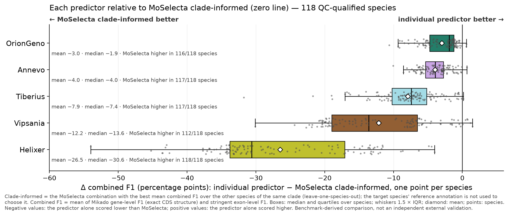
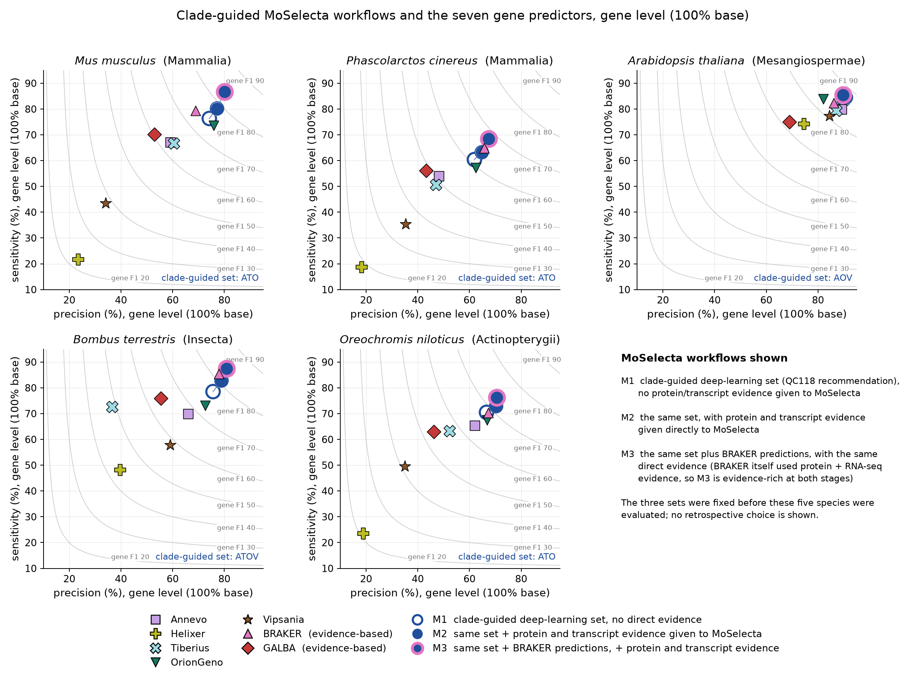

# MoSelecta v0.3.0 benchmark results and methodology

## Contents

- [Why benchmark MoSelecta?](#why-benchmark-moselecta)
- [Results at a glance](#results-at-a-glance)
- [Benchmark 1: 118 species, five deep-learning predictors, no direct evidence](#benchmark-1-118-species-five-deep-learning-predictors-no-direct-evidence)
- [Benchmark 2: five species with evidence-based predictors and direct evidence](#benchmark-2-five-species-with-evidence-based-predictors-and-direct-evidence)
- [Key conclusions](#key-conclusions)
- [Methods and limitations](#methods-and-limitations)
- [Further information](#further-information)

## Why benchmark MoSelecta?

Gene predictors disagree. Different methods propose competing coding-sequence
(CDS) structures for the same locus, and which method is most accurate changes with the
organism and with the level at which accuracy is measured: the predictor
with the most exactly correct gene models is often not the one with the most
correct exons. A user who has run several predictors therefore faces two
practical questions: which single annotation to trust, and whether combining
them would be better than any one of them.

MoSelecta addresses the second question. It compares the candidate coding
structures from every source, scores each on structural support from the
other sources and on model quality, and selects a compatible set of gene
models with an auditable decision trail. An optional genome FASTA supplies
sequence context for integrity checks and post-selection refinement, and
optional protein and transcript alignments supply external evidence. It does
not take a majority vote and it does not require external evidence.

The two benchmarks on this page cover two situations with different evidence
requirements:

1. **No direct evidence.** MoSelecta integrates predictions from
   deep-learning gene predictors using only the prediction annotations and
   the genome FASTA, with no protein or transcript alignments. This is the
   setting of the 118-species study.
2. **Evidence available.** Protein and transcript alignments are supplied to
   MoSelecta directly, and evidence-based predictors (BRAKER, GALBA) are
   available as additional sources. This is the setting of the study of five
   additional species absent from the 118-species panel.

On this page "direct evidence" means protein or transcript alignments
supplied to MoSelecta. The genome FASTA is sequence context, not evidence
for a gene model, and it was supplied in every run of both studies.

Both studies measure accuracy against public reference annotations with
Mikado `compare`, using exact CDS structure at gene level and a stringent
exon-level comparison (see [Methods](#methods-and-limitations)). In
Benchmark 1 the species is the statistical unit: every comparison is paired
within a species and summarised over 118 species. Benchmark 2 is a
descriptive study of five species, with repeated comparisons of combinations
within each species. Differences are given in combined-F1 points, that is,
differences on the 0 to 100 F1 scale, not percentage changes.

## Results at a glance

| Study | Question | Headline result |
|---|---|---|
| Benchmark 1: 118 species, no direct evidence | Does integration beat a realistic single-predictor choice? | Clade-informed MoSelecta gave higher combined F1 than the clade-informed single predictor in **111 of 118 species**, with a mean gain of **+2.10 combined-F1 points**. A fixed three-predictor combination (ATO) did so in 107 of 118, with a mean gain of +1.83. |
| Benchmark 2: five additional species | Do the 118-species recommendations transfer? | Without direct evidence, the recommended combination was the best of the 16 deep-learning combinations in **4 of 5 species** and 0.02 points behind the best in the fifth. |
| Benchmark 2 | Does direct evidence help? | With protein alignments, MoSelecta was above the strongest predictor included in each combination in **80 of 80** combination-species cases (16 combinations × 5 species), against 62 of 80 without direct evidence. |
| Benchmark 2 | What do BRAKER models add? | Adding BRAKER predictions to the recommended combination, with direct evidence, gave a further +1.1 to +2.6 points in four species and +0.07 in *Arabidopsis*. |

The comparators, the qualifications on each result and the limitations are
set out in the sections below.

## Benchmark 1: 118 species, five deep-learning predictors, no direct evidence

### Design

- **Species.** 120 species were surveyed, 20 in each of six clades (Fungi,
  Insecta, Aves, Actinopterygii, Mesangiospermae, Mammalia). Two fungal
  reference annotations (*Rhizopus delemar*, *Sugiyamaella lignohabitans*)
  failed an independent BUSCO-based reference-quality check and were
  excluded from the primary accuracy evaluation. The primary panel is
  therefore **118 species: 18 fungi and 20 species in each of the five other
  clades**.
- **Predictors.** Five deep-learning gene predictors: Annevo 2.3.2 (A),
  Helixer 0.3.7 (H), OrionGeno 2026.4.17_37559f6 (O), Tiberius 2.0.7 (T)
  and Vipsania 1.0.0 (V). Combinations are named by these letters; for
  example **ATO** is Annevo + Tiberius + OrionGeno.
- **MoSelecta runs.** All 16 three-, four- and five-predictor combinations
  for every species: **1,888 MoSelecta evaluations**. Each run received the
  prediction annotations and the genome FASTA (sequence context for
  integrity checks and refinement). No protein or transcript alignments were
  supplied.
- **Build.** MoSelecta `0.2.16.dev0`, a development build of the v0.3.0 code
  line, run with `--strict --pruning-level auto --output-profile minimal
  --add-utrs`.

### Evaluation measures

- **Gene F1**: Mikado gene-level F1 at the 100%-base criterion, so a
  predicted gene counts only if its CDS structure exactly matches a reference
  transcript.
- **Exon F1**: Mikado stringent exon-level F1.
- **Combined F1**: the arithmetic mean of gene F1 and exon F1 for each
  species.

The main results use combined F1, and all recommendations were selected on
combined F1. The mean gain was larger in gene F1 than in exon F1 (for fixed
ATO, +2.21 and +1.45 points over the clade-informed single predictor), and
both contribute to the combined gain. Exon F1 is higher and more compressed
across the strong predictors. Selecting on gene F1 alone gives the same
recommended combination in every clade; selecting on exon F1 alone would
change it in three clades, by margins of at most 0.04 points. Other
objectives could therefore give different choices.

### Result A: MoSelecta compared with a realistic single-predictor choice

The fair comparator is not the best predictor chosen with hindsight, but the
predictor a well-informed user could pick in advance. Here that is the
**clade-informed single predictor**: for each species, the predictor with the
highest mean combined F1 over the *other* species of the same clade
(leave-one-species-out, LOSO). The same predictor was selected in every
fold of a clade: OrionGeno in the three vertebrate clades, Annevo in insects
and plants and Vipsania in fungi. It never uses the target species'
reference. Across the 118 species it averages 77.82 combined F1, 0.9 points
above using OrionGeno everywhere (76.92) and 0.34 below the retrospective
best of the five predictors per species (78.16).

Three practical MoSelecta strategies were compared with it:

| Strategy | Mean combined F1 | Mean gain over clade-informed single predictor (95% CI) | Species improved |
|---|---:|---:|---:|
| Clade-informed single predictor (comparator) | 77.82 | baseline | — |
| MoSelecta, fixed ATO | 79.65 | +1.83 (1.46 to 2.21) | 107 of 118 |
| MoSelecta, score-selected top three | 79.82 | +2.00 (1.65 to 2.35) | 109 of 118 |
| MoSelecta, clade-informed combination | 79.92 | +2.10 (1.77 to 2.48) | 111 of 118 |

*118 species; combined F1 = mean of gene and exon F1 per species; paired
differences, species bootstrap CIs. "Species improved" counts species in
which MoSelecta is strictly higher; there are no ties at two decimals. The
median gains are +1.44, +1.46 and +1.51.*

The three strategies differ in what they require:

- **Fixed ATO** is a single benchmark-informed recipe: run Annevo, Tiberius
  and OrionGeno and integrate them. It was identified as the best fixed
  combination on this panel, so this is a benchmark-informed result rather
  than an independent validation. Its worst case is −4.6 points
  (*Cutaneotrichosporon cavernicola*, a fungus where Vipsania alone is
  strong).
- **Score-selected top three** is a two-stage benchmark heuristic, not a
  MoSelecta feature. All five predictions were integrated once, and the
  three sources with the highest source-level mean scaled score in that run
  were then integrated again. It needs no reference for the target species
  but does need all five predictions and two MoSelecta runs. It selected ATO
  in 56 of the 118 species, and its worst case is −1.4 points. Source-level
  scores are not validated estimates of predictor accuracy: the three
  highest-scoring sources were the three most accurate predictors in 82 of
  118 species, and in only 7 of 20 plants. On this panel the heuristic was
  associated with good integration outcomes, but it is not a shipped or
  validated subset recommender and does not show that three inputs are
  universally optimal.
- **Clade-informed combination** is selected leave-one-species-out: for each
  target species, the combination with the highest mean combined F1 over the
  other 17 or 19 species of its clade, evaluated on the held-out species.
  The selected combination was the full-clade recommendation of Result C in
  117 of the 118 folds (one insect fold selected AOV rather than ATOV), so
  this row is close to, but not literally, the performance of one fixed
  recommendation per clade. Its worst case is −1.5 points.

For comparison, the five-predictor combination HATOV gains only +1.29 on
average (85 of 118 species improved) and has the largest failures (−10.4 in
*Melospiza melodia*), and the retrospective best of the 16 combinations,
which is not available without a reference, gains +2.28 (113 of 118). The
practical strategies therefore realise most of the gain of the
retrospectively best of the 16 tested combinations.

The gain persists in the vertebrate clades, where OrionGeno was consistently
the strongest individual predictor in this benchmark. OrionGeno is the best
predictor in all 60 vertebrate species, yet fixed ATO is higher than
OrionGeno in 59 of 60 (mean +1.19 Aves, +1.21 Actinopterygii, +1.64
Mammalia). The gain is largest where single-predictor choice is hardest:
insects (+4.8 to +5.5 over Annevo, 20 of 20 for every practical strategy) and
plants (+1.8 to +2.2 over Annevo). Fungi are the exception: the best
strategies gain +0.9 over Vipsania (12 of 18 species) and are level with the
retrospective best predictor on average.

### Result B: improvement over each named predictor

**Each predictor relative to the clade-informed MoSelecta combination, 118
species.** **Negative values mean the predictor alone scored lower than
MoSelecta.** MoSelecta is higher than OrionGeno in 116 of 118 species (mean
difference −3.0, median −1.9), than Annevo in 117 (−4.0, −4.0), Tiberius in
117 (−7.9, −7.4), Vipsania in 112 (−12.2, −13.6) and Helixer in 118 (−26.5,
−30.6). All ten species-bootstrap 95% CIs (these five and the same
comparison for fixed ATO) exclude zero. This is a benchmark-derived
comparison, not an independent external validation.

This view answers the question of a user who already runs one predictor
everywhere: the comparison includes clades where that predictor is not the
best choice, so the gains are larger than in Result A. Every loss greater
than one point is in fungi against Vipsania (two species, worst *Lichtheimia
ornata* −1.5); outside fungi the only loss is *Melospiza melodia* against
OrionGeno (−0.5). In the three vertebrate clades
the clade-informed combination is ATO, so this figure and the equivalent
plot for fixed ATO coincide there.

### Result C: which input combinations work best?

Two different analyses bear on this question and they are kept apart here.

**Full-panel clade guidance (descriptive).** Over all the species of each
clade, the combination with the highest mean combined F1 is the
benchmark-derived recommendation for new genomes of similar lineages:

| Clade (species) | Best single predictor (mean F1) | Recommended combination (mean F1) | Other combinations within 0.25 points |
|---|---|---|---|
| Mammalia (20) | OrionGeno (78.80) | **ATO** (80.44) | HATO (80.23) |
| Aves (20) | OrionGeno (79.32) | **ATO** (80.51) | none |
| Actinopterygii (20) | OrionGeno (80.13) | **ATO** (81.34) | HAO (81.19), AOV (81.10) |
| Mesangiospermae (20) | Annevo (76.95) | **AOV** (79.13) | ATV (78.92) |
| Insecta (20) | Annevo (72.66) | **ATOV** (78.14) | AOV (78.09), HATOV (77.93) |
| Fungi (18) | Vipsania (79.19) | **ATOV** (80.08) | TOV (80.00), AOV (79.94) |

*A = Annevo, H = Helixer, O = OrionGeno, T = Tiberius, V = Vipsania. Mean
combined F1 over every species of the clade. These values are descriptive:
each species contributed to the recommendation it is scored against.*

**Within-clade LOSO evaluation (held out).** To test such guidance on
species that did not contribute to it, the selection was repeated
leave-one-species-out. For each target species, the combination and,
separately, the single predictor with the highest mean combined F1 over the
other 17 or 19 species of the clade were selected and then evaluated on the
held-out species. This is the "clade-informed" comparison of Result A:

| Clade (species) | Combination selected across the LOSO folds | Single predictor selected | Mean gain of selected combination over selected predictor | Species improved |
|---|---|---|---:|---:|
| Mammalia (20) | ATO in all 20 | OrionGeno in all 20 | +1.64 | 20 of 20 |
| Aves (20) | ATO in all 20 | OrionGeno in all 20 | +1.19 | 19 of 20 |
| Actinopterygii (20) | ATO in all 20 | OrionGeno in all 20 | +1.21 | 20 of 20 |
| Mesangiospermae (20) | AOV in all 20 | Annevo in all 20 | +2.18 | 20 of 20 |
| Insecta (20) | ATOV in 19, AOV in 1 | Annevo in all 20 | +5.37 | 20 of 20 |
| Fungi (18) | ATOV in all 18 | Vipsania in all 18 | +0.90 | 12 of 18 |
| All (118) | full-panel recommendation in 117 of 118 | full-panel best predictor in 118 of 118 | +2.10 | 111 of 118 |

*Combined-F1 points; both selections exclude the target species.*

Two cautions. First, the leading fungal and insect combinations are
separated by very small margins (0.08 and 0.05 combined-F1 points) and by
species counts of 10 to 8 and 13 to 7 against their nearest alternatives.
Differences this small do not support a strong preference among the leading
combinations, and the fungal preference between ATOV and AOV depends on
which reference annotations are included. Second, the recommended
combination has three predictors in four clades and four in two; the
five-predictor combination is never preferred. None of this establishes a
universal optimal number of inputs, and the guidance applies to these five
predictors as run in this benchmark.

### Result D: gene recovery and precision

F1 does not capture everything a user cares about. Two complementary
measures are the share of reference genes that no predicted gene overlaps
("missed", lower is better) and the share of predicted genes that overlap no
reference gene ("unmatched", lower is better on a complete reference).
Integration moves both, in opposite directions depending on how many sources
are used (species means, 118 species):

- The five-predictor combination HATOV misses the fewest reference genes
  (6.5%, against 8.9% for the clade-informed single predictor) but leaves the
  most predictions unmatched (10.7%, against 8.7%).
- The three-predictor strategies leave the fewest unmatched predictions
  (fixed ATO 8.0%, score-selected top three 7.0%) while missing 7.8% and
  8.3% of reference genes respectively.
- The clade-informed combination sits between (7.7% missed, 7.8% unmatched).

Mean combined F1 is 0.5 to 0.7 points higher for the two three-predictor
strategies than for the five-predictor combination, but a project that
values completeness might prefer a four- or five-predictor
combination and accept more unmatched models. An unmatched predicted gene is
not necessarily wrong: reference annotations are incomplete, particularly
for lineage-specific genes, and some unmatched MoSelecta models are supported
by several independent predictors. Equally, fewer unmatched predictions
cannot be read as proof of higher biological precision.

## Benchmark 2: five species with evidence-based predictors and direct evidence

### Design

- **Species.** *Mus musculus* (Mammalia), *Phascolarctos cinereus*
  (Mammalia), *Arabidopsis thaliana* (Mesangiospermae), *Bombus terrestris*
  (Insecta) and *Oreochromis niloticus* (Actinopterygii). These are five
  additional species absent from the 118-species panel.
- **Predictors.** Seven: the five deep-learning predictors above (same
  versions) plus two evidence-based predictors, BRAKER (B; BRAKER4
  0.6.0-beta, protein and RNA-seq evidence) and GALBA (G; version
  0.6.0-beta, protein evidence).
- **MoSelecta combinations.** The 16 deep-learning combinations of
  Benchmark 1 (EXP1) and ten combinations that add BRAKER, GALBA or both to
  each of the three clade-guided deep-learning combinations (ATO, AOV,
  ATOV) or to all five deep-learning predictors (EXP2). Every combination
  was run on every species.
- **Direct evidence modes.** Each combination was run four times: with no
  direct evidence supplied to MoSelecta, with protein alignments (miniprot),
  with transcript assemblies (StringTie from RNA-seq) and with both. The
  genome FASTA was supplied in every run, as in Benchmark 1. In total
  **520 MoSelecta runs** (5 species × 26 combinations × 4 modes).
- **Build.** MoSelecta `0.2.16`, the build that became the v0.3.0 release,
  with the same options as Benchmark 1.

The clade guidance from Benchmark 1 was fixed before these species were
evaluated: single predictor OrionGeno for the vertebrates and Annevo for the
insect and the plant; MoSelecta combination ATO for the three vertebrates,
AOV for *Arabidopsis* and ATOV for *Bombus*. These QC118-derived
recommendations are called **clade-guided** below and in the figures, to
distinguish them from the leave-one-species-out **clade-informed** selections
evaluated within Benchmark 1.

### Result A: the earlier recommendations remain effective

Without direct evidence, the clade-guided MoSelecta combination was the
best of the 16 deep-learning combinations in four of the five species and
0.02 points behind the best in the fifth, and it exceeded the
clade-guided single predictor in all five:

| Species (clade) | Recommended combination | Combined F1, no direct evidence | Rank among 16 | Retrospective best of 16 (F1) | Gain over clade-guided predictor | Difference from BRAKER |
|---|---|---:|---:|---|---:|---:|
| *Mus musculus* (Mammalia) | ATO | 80.76 | 1 | ATO (80.76) | +1.32 (OrionGeno) | +2.06 |
| *Phascolarctos cinereus* (Mammalia) | ATO | 73.95 | 1 | ATO (73.95) | +2.28 (OrionGeno) | +1.73 |
| *Arabidopsis thaliana* (Mesangiospermae) | AOV | 88.29 | 1 | AOV (88.29) | +1.85 (Annevo) | +2.24 |
| *Bombus terrestris* (Insecta) | ATOV | 82.91 | 2 | ATO (82.93) | +5.53 (Annevo) | −2.52 |
| *Oreochromis niloticus* (Actinopterygii) | ATO | 78.44 | 1 | ATO (78.44) | +1.18 (OrionGeno) | +1.61 |

*Combined F1. The "retrospective best of 16" is chosen with the species'
reference after the fact and is not an available prospective strategy. BRAKER
used protein and RNA-seq evidence; the MoSelecta runs in this table used
none.*

The margins at the top are small (in *Arabidopsis* ATOV is 0.01 behind AOV),
so the result is best read as the recommended combination being at or within
0.02 points of the top of the 16, rather than uniquely best. The recommended combination also
exceeded the retrospective best deep-learning predictor in every species
(+1.2 to +4.2) and exceeded BRAKER in four of five without any direct
evidence; *Bombus*, where BRAKER is 6.7 points ahead of every deep-learning
predictor, is the exception.

### Result B: direct evidence improves MoSelecta's integration

Within the 16 deep-learning combinations, MoSelecta was compared with the
strongest predictor included in each combination (not the best of all
seven). That predictor is identified retrospectively from its score against
the reference, so this is a diagnostic comparator, not a prospective
selection rule. The count of combinations in which MoSelecta is higher, over
the five species, is:

| Direct evidence supplied to MoSelecta | MoSelecta higher than its best included predictor | Range across the five species of the species mean gain over 16 combinations |
|---|---:|---:|
| None | 62 of 80 | −0.4 to +3.5 |
| Protein | 80 of 80 | +2.2 to +5.8 |
| Transcript | 74 of 80 | +0.4 to +5.0 |
| Protein + transcript | 80 of 80 | +2.3 to +6.0 |

*The 80 comparisons are 16 combinations × 5 species: repeated comparisons
within five species, not 80 independent observations. The counts describe
how robust the gain is to the choice of inputs within each species. No
ties. Gains in combined-F1 points.*

Without evidence the gain is universal in *Arabidopsis* and *Bombus* (16 of
16), near-universal in *Phascolarctos* (15), but holds in only 9 of 16
combinations in *Mus* and 6 of 16 in *Oreochromis*. The losing combinations
are predictable: those that pair OrionGeno with Helixer and Vipsania but
neither Annevo nor Tiberius, and the four- and five-predictor combinations in
the fish. No loss exceeds 4 points, the losses are in gene-level precision,
and exon F1 still improves in 71 of 80 runs.

In these five species and input sets, protein alignments accounted for most
of the observed direct-evidence gain: with protein alignments all 80
combination-species cases are wins, the mean gain over no evidence is +2.4
to +2.9 points outside *Arabidopsis* (+0.6 there, where the predictors are
already strong), and adding transcripts on top of proteins adds a further
0.05 to 0.20. Transcript evidence alone gave between about a third and two
thirds of the gain of protein evidence outside *Arabidopsis*. Because these runs contain only the five deep-learning
predictors, they isolate the contribution of evidence supplied directly to
MoSelecta, without any BRAKER or GALBA models.

### Result C: comparison with evidence-based predictors

**Combined F1 of practical annotation workflows and individual gene
predictors on five species.** One panel per species on a common axis, six
workflows in the same order in every panel: the clade-guided
deep-learning predictor (OrionGeno for vertebrates, Annevo for the insect and
the plant), BRAKER (protein + RNA-seq evidence), GALBA (protein evidence) and
three MoSelecta workflows (shaded rows): the clade-guided deep-learning
combination with no direct evidence; the same combination with protein and
transcript evidence given to MoSelecta; and the same combination plus BRAKER
predictions, with the same direct evidence. Every workflow shown was fixed
before these species were evaluated; no retrospective choice is drawn.
Values (combined F1, species in the order *Mus*, *Phascolarctos*,
*Arabidopsis*, *Bombus*, *Oreochromis*): clade-guided predictor 79.4,
71.7, 86.4, 77.4, 77.3; BRAKER 78.7, 72.2, 86.0, 85.4, 76.8; MoSelecta
without evidence 80.8, 74.0, 88.3, 82.9, 78.4; with protein + transcript
evidence 82.8, 75.9, 88.8, 85.2, 80.4; with BRAKER and evidence 85.4, 78.3,
88.9, 87.5, 81.5.

This is a comparison of workflows, not of independent evidence sources. The
BRAKER and GALBA models were generated from the same or overlapping protein
and RNA-seq inputs that are supplied directly to MoSelecta in the evidence
modes (see [Evidence reuse](#evidence-reuse-in-benchmark-2)).

Four observations follow:

- **Deep-learning-only MoSelecta approaches or exceeds BRAKER without direct
  evidence** in four of the five species (+1.6 to +2.2 points) and trails it
  only in *Bombus* (−2.5), where no deep-learning combination reaches BRAKER.
- **Supplying protein and transcript evidence directly to MoSelecta improves
  accuracy** in every species (+0.5 to +2.3 over the same combination
  without evidence). With evidence, the deep-learning-only combination
  exceeds BRAKER by +2.7 to +4.1 in four species and is level in *Bombus*
  (−0.3).
- **Adding BRAKER predictions to the clade-guided combination gives a
  further gain** in four species: +2.6 (*Mus*), +2.4 (*Phascolarctos*,
  *Bombus*) and +1.1 (*Oreochromis*) with direct evidence. In
  *Arabidopsis* the gain is +0.07 with evidence (+0.35 without); adding
  BRAKER does not always help much. Adding GALBA instead adds less (+0.0 to
  +1.3 outside *Arabidopsis*) and lowers F1 in *Arabidopsis*; adding both
  exceeds adding BRAKER alone only without direct evidence, and then only in
  three of the five species.
- **The size of the gain and the best combination differ among species.**
  The clade-guided combination plus BRAKER with evidence is the
  highest-scoring of the six prespecified workflows shown in all five
  species, and is 2.1 to 6.7 points above BRAKER alone. Among the ten EXP2
  combinations run with the same protein + transcript evidence it is the
  retrospective best in three of five species (*Mus*, *Oreochromis*,
  *Phascolarctos*); in *Arabidopsis* ATO + BRAKER is 0.03 above it (88.89
  against 88.86) and in *Bombus* AOV + BRAKER is 0.87 above it (88.41
  against 87.54). The seven-predictor combination is never the best.

### Result D: sensitivity and precision

**Gene-level sensitivity against precision for the seven predictors and
three clade-guided MoSelecta workflows, five species.** Gene level at
the 100%-base criterion (exact CDS structure); grey curves are iso-gene-F1
lines. Marker shapes identify the five deep-learning predictors (Annevo,
Helixer, Tiberius, OrionGeno, Vipsania) and the two evidence-based predictors
(BRAKER, GALBA). The three MoSelecta workflows, M1 to M3 in the figure key,
are those of the previous figure.

The figure shows how evidence and BRAKER models change the operating point
rather than simply raising F1. Without evidence (M1), MoSelecta has a higher
gene F1 than the best deep-learning predictor in every species, but it does
not dominate on both axes: its sensitivity exceeds the highest deep-learning
sensitivity in four species, while its precision is slightly below
OrionGeno's in *Mus*, *Phascolarctos* and *Oreochromis*. Direct evidence (M2)
raises both sensitivity (+0.7 to +4.3) and precision (+0.8 to +3.7) and
places MoSelecta above both deep-learning maxima in all five species. Adding
BRAKER (M3) adds a further, larger sensitivity gain (+1.0 to +6.5) at similar
or slightly lower precision, and gives the highest gene-level sensitivity of
any point in every species, including BRAKER itself. A higher combined F1
therefore does not mean that sensitivity and precision both improved: the
BRAKER step is mainly a sensitivity gain, and in *Arabidopsis* it costs
1.1 points of gene precision.

The same pattern appears in gene recovery. Without evidence, the
clade-guided combination misses 2.9 to 5.9 points fewer reference genes
than the best deep-learning predictor and 2.2 to 9.5 fewer than BRAKER, while
leaving 3.7 to 13.6 points fewer predictions unmatched than BRAKER, which
leaves 12 to 22% of its genes unmatched outside *Arabidopsis*. Adding BRAKER,
then GALBA, then all seven predictors recovers progressively more reference
genes at the price of more unmatched predictions.

## Key conclusions

1. **Integrating complementary gene predictions can improve accuracy beyond
   the individual methods.** On 118 species, practical MoSelecta strategies
   gave higher combined F1 than the single predictor selected
   leave-one-species-out for the clade, by +1.8 to +2.1 combined-F1 points
   on average and in 107 to 111 of 118 species. The clade-informed
   combination was higher than each named predictor in 112 to 118 of 118
   species (fixed ATO: 109 to 118).
2. **These gains do not require protein or transcript evidence.**
   Benchmark 1 supplied MoSelecta with the prediction annotations and the
   genome FASTA, which gives sequence context for integrity checks and
   refinement, and with no protein or transcript alignments.
3. **Benchmark-informed input combinations are useful guidance.** The clade
   recommendations from the 118-species panel (ATO for vertebrates, AOV for
   plants, ATOV for insects and fungi) were the best of the 16 deep-learning
   combinations in four of five additional species and within 0.02
   combined-F1 points of the best in *Bombus*, and were above the
   recommended single predictor in all five.
4. **Protein and transcript evidence add discrimination.** In these five
   species, protein alignments raised MoSelecta above the retrospectively
   strongest predictor included in each combination in all 80
   combination-species cases (16 combinations × 5 species), against 62 of 80
   without direct evidence. These are repeated comparisons within five
   species, not 80 independent observations. Protein alignments accounted
   for most of the observed direct-evidence gain.
5. **Evidence-based predictors, particularly BRAKER, can contribute further
   information.** Adding BRAKER models to the clade-guided combination, with
   direct evidence, gave +1.1 to +2.6 points in four of five species (+0.07
   in *Arabidopsis*), mainly through gene-level sensitivity. The resulting
   workflow was the highest-scoring of the six prespecified workflows
   compared in all five species; among the ten tested combinations
   containing BRAKER or GALBA with the same evidence, it was retrospectively
   best in three of five. BRAKER's models and MoSelecta's direct alignments
   reuse the same or overlapping biological evidence, so this is a workflow
   comparison, not a comparison of independent evidence sources.
6. **The most appropriate combination depends on the sources, the evidence
   available and the sensitivity-precision balance wanted.** On the
   118-species panel the tested three-source strategies had the highest
   overall mean combined F1 and fewer unmatched models, while larger source
   sets recovered more reference genes; in insects and fungi the leading
   combination had four sources. The benchmarks do not establish a
   universally optimal number of inputs, do not provide an automatic way to
   identify the best source subset for a new genome, and do not show which
   pruning level will be optimal for every project.

## Methods and limitations

### Species and references

Benchmark 1 began as a 120-species survey, 20 per clade, each with an NCBI
genome assembly and reference annotation. A reference-quality check based on
BUSCO completeness of the reference proteome against the genome (independent
of any predictor or MoSelecta result) excluded two fungal references,
leaving 118 species: 18 fungi and 20 in each of the five other clades.
Benchmark 2 used five additional species absent from that panel,
with reference annotations filtered to coding transcripts and de-duplicated.
The deep-learning predictors were run on genomes cleaned of organellar and
very short sequences; BRAKER and GALBA models on removed sequences were
dropped. Absolute F1 values are not directly comparable between the two
studies because of these differences; directions and ranks are.

### Predictors

Annevo 2.3.2, Helixer 0.3.7, OrionGeno 2026.4.17_37559f6, Tiberius 2.0.7
and Vipsania 1.0.0 were run as distributed, without per-clade retraining or
tuning; their relative performance here reflects those released models. In
Benchmark 2, BRAKER (BRAKER4 0.6.0-beta: GeneMark-ETP, AUGUSTUS, TSEBRA,
with protein and RNA-seq hints) and GALBA (version 0.6.0-beta, protein hints
only) were run with their optimisation settings. Predictions were
standardised to coding structures before comparison.

### MoSelecta builds and settings

Benchmark 1 used MoSelecta `0.2.16.dev0` (1,888 runs); Benchmark 2 used
MoSelecta `0.2.16` (520 runs), the build that became this release.
Both are builds of the v0.3.0 code line and were run with
`--strict --pruning-level auto --output-profile minimal --add-utrs`; a small
number of Benchmark 1 runs added a per-source gene cap for very large
superloci. Default scoring, selection, backfill and automatic-pruning
settings were used throughout; no parameter was tuned per species. Every
run in both studies received the genome FASTA, which MoSelecta uses as
sequence context for integrity checks and post-selection refinement; it is
not counted as direct evidence on this page. The UTR-augmented final
annotation was the evaluated product in both studies.

### Evaluation

Mikado `compare` (Mikado v2.3.4) was run for each annotation against the
species' reference.
Gene F1 is the gene-level F1 at the 100%-base criterion (exact CDS
structure); exon F1 is the stringent exon-level F1; combined F1 is their
mean for each species. Missed and unmatched gene fractions are Mikado's
"missed genes" and "novel genes" at zero nucleotide F1. In Benchmark 1 the
species is the unit: comparisons are paired within species, summarised as
means (with species-bootstrap 95% confidence intervals, 2,000 replicates),
medians and win counts over 118 species. In Benchmark 2, with five species,
no confidence intervals or tests are given; comparisons are paired within
species and reported per species or as counts over species × combinations.

### Comparators: realistic and retrospective choices

Every result distinguishes choices that a user could make in advance from
choices that need the target species' reference. The clade-informed single
predictor and clade-informed MoSelecta combination are selected
leave-one-species-out (LOSO) from the other species of the clade; the
selected combination equals the full-panel clade recommendation in 117 of
118 folds and the selected predictor in all 118. Fixed ATO and the
score-selected top three need no reference for the target species but were
identified or motivated on the 118-species panel, so they are
benchmark-informed rather than independently validated. "Retrospective best" predictors and combinations
are chosen with the reference after the fact and are shown only as upper
bounds. In Benchmark 2 the recommended combinations were fixed before
evaluation, but the MoSelecta configuration itself was developed partly on
earlier inputs for these five species, so Benchmark 2 is not a blind test of
the software.

### Evidence reuse in Benchmark 2

BRAKER and GALBA generate predictions from evidence. BRAKER used the same
RNA-seq runs as MoSelecta's StringTie transcript evidence (identical sets in
three species, a superset in two) and the same related-species proteomes as
MoSelecta's miniprot protein evidence; GALBA used BRAKER's protein set.
Consequently the EXP2 runs labelled "no direct evidence" are **not**
evidence-free workflows, and in an EXP2 run with direct evidence the same or
overlapping biological evidence is used both in generating the BRAKER and
GALBA predictions and directly by MoSelecta. The evidence-based predictions
and the direct evidence must not be described as independent evidence
sources. The smaller evidence gains in EXP2 (+1.4 to +2.0 against +2.5 to
+3.1 for deep-learning combinations in the four non-plant species) are
consistent with this overlap, although the benchmark does not isolate its
cause.

### Limitations

- **Reference annotations are imperfect.** All accuracy values are relative
  to public references that are themselves incomplete and partly
  computational; a prediction unmatched to the reference is not a proven
  false positive, and a reference gene missed by every method may be wrong.
- **Benchmark 2 is small.** Five species, two of them mammals and one each
  from three other clades, with no fungi or birds (the clades where
  Benchmark 1 found the smallest and most variable gains). It supports the
  transfer of the clade guidance and the effect of evidence in these
  species; it does not establish universal generalisation. The *Bombus*
  result, where BRAKER is far ahead of every deep-learning predictor, is one
  insect.
- **Scope of the guidance.** The clade recommendations apply to these five
  deep-learning predictors as run here. Fungal and insect rankings rest on
  margins of less than 0.1 combined-F1 points, which do not support a strong
  preference among the leading combinations.
- **F1 is one summary.** The three-source strategies had the highest overall
  mean combined F1 but realised only part of the sensitivity available from
  the union of the predictors; projects with different priorities may prefer larger
  combinations.
- **Evidence and compute.** The direct-evidence and BRAKER workflows need
  protein alignments, RNA-seq assemblies and, for BRAKER, a separate run of
  several hours; MoSelecta's own runtime on these five genomes was 3 to 41
  minutes and 4 to 30 GB of memory depending on the combination and evidence.

### Data and code availability

The benchmark run outputs, Mikado comparison tables and analysis scripts are
held by the Earlham Institute and are not included in this release. Requests
for the underlying tables can be directed to the author via the contact
details in the repository. No MoSelecta publication or DOI is available at
the time of this release.

## Further information

- [README](../README.md): overview, installation pointers, first run and
  main outputs.
- [Installation](../INSTALLATION.md).
- [User guide](user-guide/MoSelecta-v0.3.0-user-guide.pdf): routine usage,
  workflows, interpretation and troubleshooting. The user guide remains
  authoritative for usage; this page is authoritative for the benchmark
  claims.
- [Configuration reference](configuration.md): every option, including
  `--pruning-level` and the evidence inputs used in these benchmarks.
- [Scoring and model ranking](technical/scoring.md): how structural support,
  model quality and optional evidence are combined.
- [Selection, conflict resolution and backfill](technical/selection-and-backfill.md),
  [Automatic final pruning](technical/automatic-pruning.md),
  [Alternative transcripts](technical/alternative-transcripts.md),
  [UTR augmentation](technical/utr-augmentation.md).
- [Output reference](outputs.md): the files and fields written by a run.
- [Release notes](release-notes/release-notes.md).
